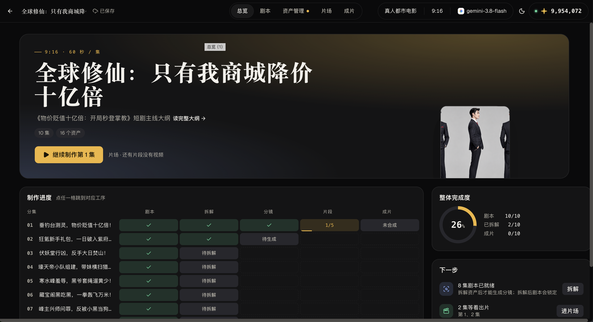
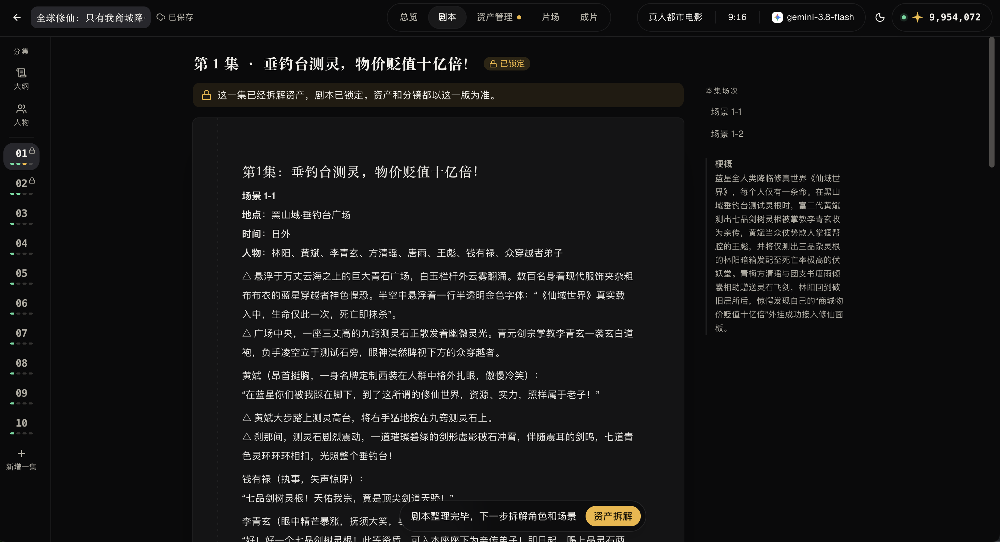
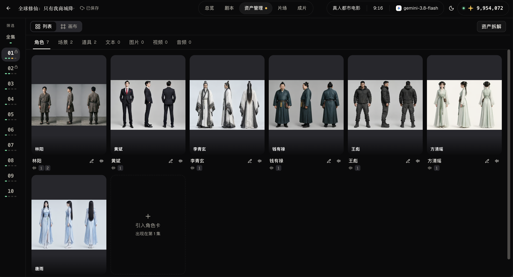
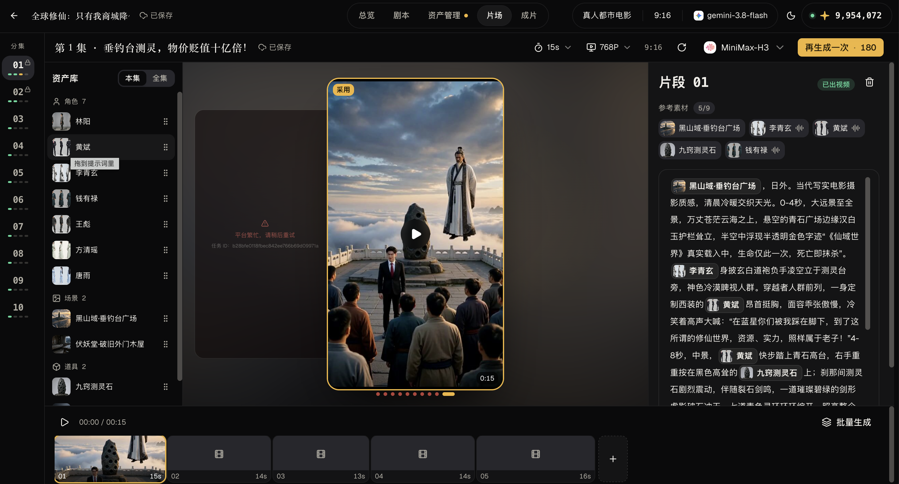
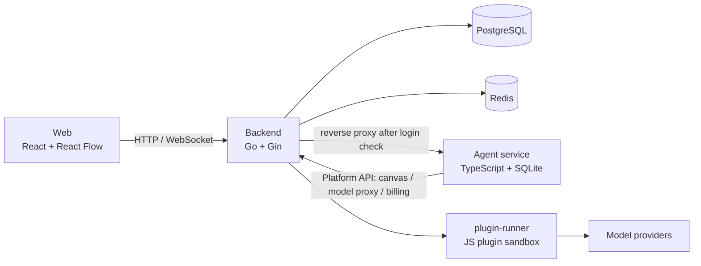

<p align="center">
  <picture>
    <source media="(prefers-color-scheme: dark)" srcset="docs/assets/brand/logo-dark.svg" />
    
  </picture>
</p>

<div align="center">

# 连镜

**A self-hosted AI visual creation platform: infinite canvas · Drama Studio · canvas Agent**

Import a script or novel, break it into characters and shots, and connect the steps on a canvas to generate video.
Accounts, credits, model channels, usage and audit logs are all built in, and one command deploys it for your team.

[Live demo](https://canvas.vbing.site) · [Quick start](#quick-start) · [Features](#walkthrough) · [简体中文](README.md)

[](LICENSE)
[](https://github.com/zaylora/video-canvas/tags)
[](https://github.com/zaylora/video-canvas/actions/workflows/ci.yml)


</div>

## Who it is for

- Creators who want to turn a **novel or script** into storyboards and short-drama video
- Operators who want a shared AI creation platform for a **team or several users**, with accounts, credits, usage and audit logs
- Anyone with several model APIs who wants to **connect and bill them in one place**

## Why 连镜

- **A self-hosted platform that works for many users**: accounts, credits (frozen on submission, charged on success, refunded on failure or cancellation), payments, usage records and audit logs, all in the admin console.
- **Model access is a plugin, not hard-coded**: more than 20 built-in protocol plugins, and you can upload your own. Plugins run in an isolated plugin-runner and only do two things, turn a task into a request and turn a response into a result, with no network, file or timer access. See the [plugin contract](backend/docs/plugin-contract.md).
- **The Agent is a separate service and holds no channel keys**: the canvas Agent runs on its own and reads and writes canvases, calls models and bills through a platform API. Channel keys are stored encrypted and are write-only.
- **Upgrades can be rolled back**: the database is backed up before every upgrade and any failed step reverts to the previous version. A super admin can also upgrade from the admin console.

## Walkthrough

### 1. Drama Studio

Turn a long script or novel into episodes and storyboard video, step by step.

- Import a long script or novel, and AI reads it to produce a story outline and episode scripts.
- Characters, scenes and props are broken out and managed as shared assets.
- Shots are turned into video; when generating, a character's main image and voice are bound automatically to every shot that uses that character.

<table>
  <tr>
    <th width="50%">Workflow overview</th>
    <th width="50%">Script and story outline</th>
  </tr>
  <tr>
    <td><a href="docs/assets/screenshots/短剧工作室-总览.png"></a></td>
    <td><a href="docs/assets/screenshots/短剧工作室-剧本.png"></a></td>
  </tr>
  <tr>
    <th>Character &amp; scene asset management</th>
    <th>Storyboard &amp; video generation</th>
  </tr>
  <tr>
    <td><a href="docs/assets/screenshots/短剧工作室资产管理.png"></a></td>
    <td><a href="docs/assets/screenshots/短剧工作室分镜.png"></a></td>
  </tr>
</table>

### 2. Infinite canvas

Connect text, image, video and audio nodes. The output of an upstream node is used directly as a reference for downstream generation.

- **Media tools**: Outpaint and edit images; trim videos and capture frames. Every generation keeps its version history, and you can switch between versions at any time.
- **Canvas Agent**: Chat inside the canvas. The Agent can create, edit and arrange nodes and search the web, and its changes can be undone. Skill packs can be imported.
- **Conflict-free saving**: Canvases are saved with `revision`-based optimistic locking, so edits from several tabs or devices never overwrite each other.

<a href="docs/assets/screenshots/%E7%94%BB%E5%B8%83.png"></a>

### 3. 3D director's desk

Compose shots with mannequins, props and multiple cameras, then export camera views as videos and first-frame images back to the canvas.

<a href="docs/assets/screenshots/%E5%AF%BC%E6%BC%94%E5%8F%B0.png"></a>

### 4. Home conversations and asset library

- **Home conversations**: Pick a model and parameters on the home page and generate right away. Results are kept as a conversation and can be retried, edited, or used as references for the next generation.
- **Personal asset library**: Upload media and organize it in folders. Generated results can be added in one click and placed back onto any canvas.

<a href="docs/assets/screenshots/%E9%A6%96%E9%A1%B5.png"></a>

### 5. Generation and credits

- **Asynchronous tasks**: Submitting returns immediately. Progress is pushed over WebSocket and reconciled automatically after a reconnect. Tasks can be cancelled.
- **Credit settlement**: Credits are frozen on submission, charged on success and refunded on failure or cancellation. Online top-up is supported.

### 6. Admin console

- **Channels and models**: Connectivity is checked before saving, and a model can only be enabled after validation.
- **Operations**: Credit pricing, users, payments, usage records, audit logs and a runtime overview.
- **Secret handling**: Channel keys and storage secrets are stored encrypted and are write-only.
- **Asset storage**: Local disk is built in. In production you can add Alibaba Cloud OSS, Tencent Cloud COS, AWS S3 or Cloudflare R2 in the admin console and choose a default. Changing the default only affects new assets; existing assets are always read from the storage they were written to.
- **In-app upgrades**: With the updater enabled, a super admin can upgrade to the latest release, or roll back to the version before the last upgrade, from the admin console.

<a href="docs/assets/screenshots/%E5%90%8E%E5%8F%B0%E7%AE%A1%E7%90%86.png"></a>

## Supported models

Each provider protocol is a JS plugin running in an isolated plugin-runner process. Built-in plugins:

| Type | Built-in plugins |
| ---- | ---------------- |
| Text | OpenAI, Anthropic |
| Image | OpenAI, OpenAI-compatible (chat-based image generation), Doubao (Volcengine Ark), Alibaba Bailian |
| Video | Sora, Google Veo (Gemini API / Vertex AI), Doubao (Volcengine Ark), Jimeng, Kling, Vidu, MiniMax Hailuo, Alibaba Bailian, xAI, New API gateway |
| Audio and music | Doubao (Volcengine speech), SunoAPI (music, lyrics), Incho |

Which models you can actually use depends on what you configure and enable in the admin console channels. In a channel, enter the Base URL and API key; a channel can only be enabled after it passes the connectivity check. Missing a provider? Write a JS file following the [plugin contract](backend/docs/plugin-contract.md) and upload it.

## Architecture



## Quick start

### Deploy with Docker

The server needs [Docker](https://docs.docker.com/get-docker/) (with Compose v2) and `curl`. There is no need to clone the repository:

```bash
curl -fsSL https://raw.githubusercontent.com/zaylora/video-canvas/master/scripts/deploy.sh | bash
```

When it finishes, open `http://{your-ip}:38080`. When accessing through an IP or a domain, pass the matching address with `--origin`, e.g. `bash -s -- --origin http://{your-ip}:38080`; otherwise the cross-origin check rejects requests.

> Before running a remote script, read [`scripts/deploy.sh`](scripts/deploy.sh) and make sure you are comfortable with what it does.

### First run

1. Open the app and register. The first account in the system becomes the super admin.
2. Go to **Admin console → Channels**, choose a provider plugin, enter the Base URL and API key, and save once the connectivity check passes.
3. Fetch or create models under the channel, validate them and enable them.
4. Go back to the home page to generate, or create a canvas and organize the generation flow with nodes.

### Updates and production configuration

To update to the latest release:

```bash
curl -fsSL https://raw.githubusercontent.com/zaylora/video-canvas/master/scripts/update.sh | bash
```

For custom ports, domains, pinned versions, rollback and the full production configuration, see [Production Docker deployment](docs/docker-production.md) (Chinese).

## Documentation

Most documents are currently in Chinese.

| Topic                                     | Document                                                                                                |
| ----------------------------------------- | ------------------------------------------------------------------------------------------------------- |
| Development setup, architecture, releases | [Development guide](docs/development.en.md) · [Contributing](CONTRIBUTING.en.md)                         |
| Production deployment                     | [Production Docker deployment](docs/docker-production.md)                                               |
| Backend structure, configuration, API     | [backend/README.md](backend/README.md)                                                                  |
| AI admin API, plugin contract             | [admin-ai-api.md](backend/docs/admin-ai-api.md) · [plugin-contract.md](backend/docs/plugin-contract.md) |
| Product and interaction design            | [docs/design/](docs/design/)                                                                            |
| Changelog                                 | [CHANGELOG.md](CHANGELOG.md)                                                                            |

## Status and known limitations

Current version is 0.6.x and it moves fast. Please be aware that:

- Database migrations only move forward; a rollback can only go back to the version before the last one-click upgrade.
- One-click upgrade relies on the updater container mounting `docker.sock`, which is equivalent to root on the server, so it is off by default.
- The Agent's events and sessions have no retention cleanup yet; data only grows, so plan storage for your usage.

## Contributing

Issues, feature requests and pull requests are welcome. If you use 连镜, we would also love to hear about your workflow, your experience and any problems you run into.

Before contributing, read the [contributing guide](CONTRIBUTING.en.md) (how to file issues and open pull requests) and the [development guide](docs/development.en.md) (environment setup, coding standards, pre-submit checks).

If 连镜 is useful to you, a ⭐ Star helps more creators find it.

## License

[MIT](LICENSE)
