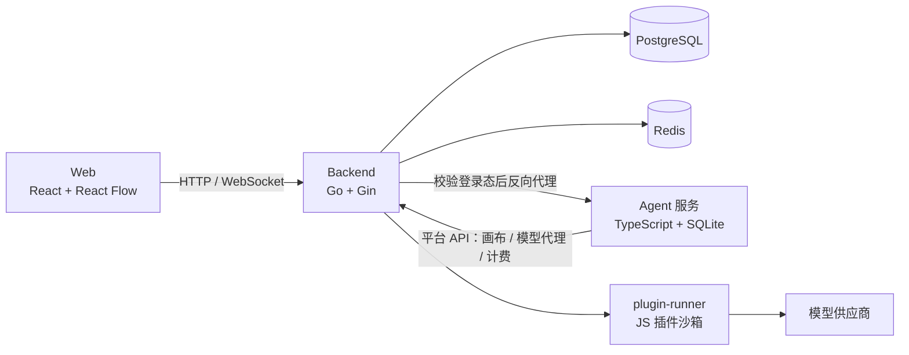

<p align="center">
  <picture>
    <source media="(prefers-color-scheme: dark)" srcset="docs/assets/brand/logo-dark.svg" />
    
  </picture>
</p>

<div align="center">

# 连镜

**自托管的 AI 视觉创作平台：无限画布 · 短剧工作室 · 画布 Agent**

导入剧本或小说，拆出角色与分镜，在画布上连成流程生成视频。
账号、积分、模型渠道、用量与审计一应俱全，一条命令部署给团队用。

[在线体验](https://canvas.vbing.site) · [一条命令部署](#快速开始) · [功能介绍](#全流程展示) · [English](README.en.md)

[](LICENSE)
[](https://github.com/zaylora/video-canvas/tags)
[](https://github.com/zaylora/video-canvas/actions/workflows/ci.yml)


</div>

## 适合谁

- 想把**小说或剧本**做成分镜与短剧视频的创作者
- 想给**团队或多人**搭一个共用的 AI 创作平台，需要账号、积分、用量与审计的运营者
- 手里有多家模型 API，想**统一接入、统一计费**的人

## 为什么选连镜

- **能给多人用的自托管平台**：账号、积分（提交时冻结，成功扣除，失败或取消退回）、支付、用量记录、操作审计，都在管理后台里。
- **模型接入是插件，不是写死的**：内置 20 多个协议插件，也可以上传自己的。插件运行在隔离的 plugin-runner 里，只做"把任务翻译成请求、把响应翻译成结果"两件事，没有网络、文件和定时器权限。详见[插件契约](backend/docs/plugin-contract.md)。
- **Agent 是独立服务，不持有渠道密钥**：画布 Agent 单独运行，通过平台 API 读写画布、调用模型和计费；渠道密钥加密保存，只能写入，不能读出。
- **升级可回退**：升级前自动备份数据库，任何一步失败自动退回原版本；超级管理员也可以在后台一键升级。

## 全流程展示

### 1. 短剧工作室

把长剧本或小说，一步步做成分集和分镜视频。

- 导入长剧本或小说，AI 研读后产出故事大纲和分集剧本。
- 自动拆出角色、场景、道具，统一管理成资产。
- 按分镜生成视频；生成时会把角色的主图与音色自动绑定到用到该角色的镜头。

<table>
  <tr>
    <th width="50%">全流程总览</th>
    <th width="50%">剧本与大纲研读</th>
  </tr>
  <tr>
    <td><a href="docs/assets/screenshots/短剧工作室-总览.png"></a></td>
    <td><a href="docs/assets/screenshots/短剧工作室-剧本.png"></a></td>
  </tr>
  <tr>
    <th>角色与场景资产管理</th>
    <th>分镜片场与视频生成</th>
  </tr>
  <tr>
    <td><a href="docs/assets/screenshots/短剧工作室资产管理.png"></a></td>
    <td><a href="docs/assets/screenshots/短剧工作室分镜.png"></a></td>
  </tr>
</table>

### 2. 无限画布

文本、图片、视频、音频节点可以互相连线，上游节点的结果直接作为下游生成的参考。

- **素材处理**：图片扩图、图片编辑；视频修剪、截取帧；生成结果保留历史版本，可随时切换。
- **画布 Agent**：在画布中对话，Agent 可以创建、编辑和排列节点，联网搜索资料，改动支持撤销；可导入技能包。
- **保存不冲突**：画布按 `revision` 乐观锁保存，多个标签页或设备同时编辑时不会互相覆盖。

<a href="docs/assets/screenshots/%E7%94%BB%E5%B8%83.png"></a>

### 3. 3D 导演台

用人台、道具和多机位摆出构图，把机位画面导出为视频和首帧图片，再放回画布。

<a href="docs/assets/screenshots/%E5%AF%BC%E6%BC%94%E5%8F%B0.png"></a>

### 4. 首页对话与资产库

- **首页对话**：在首页选择模型和参数直接发起生成，结果按对话记录保存，可重试、再编辑，或作为下一次生成的参考素材。
- **个人资产库**：上传素材、按文件夹整理，生成结果可一键入库，也可以从资产库添加到画布。

<a href="docs/assets/screenshots/%E9%A6%96%E9%A1%B5.png"></a>

### 5. 生成与积分

- **异步任务**：提交后立即返回，进度通过 WebSocket 推送，断线重连后自动对账；任务可取消。
- **积分结算**：提交时冻结积分，成功后扣除，失败或取消时退回；支持在线充值。

### 6. 管理后台

- **渠道与模型**：保存前做连通性检查，校验通过后才能启用。
- **运营管理**：积分定价、用户、支付、使用记录、操作审计和运行总览。
- **密钥安全**：渠道 Key 和存储密钥加密保存，只能写入，不能读出。
- **素材存储**：内置本地磁盘；生产环境可在后台添加阿里云 OSS、腾讯云 COS、AWS S3、Cloudflare R2，并指定默认存储。切换默认存储只影响新素材，已有素材仍从原存储读取。
- **在线升级**：启用 updater 后，超级管理员可以在后台一键升级到最新正式版本，或回退到升级前的版本。

<a href="docs/assets/screenshots/%E5%90%8E%E5%8F%B0%E7%AE%A1%E7%90%86.png"></a>

## 模型支持

每种供应商协议是一个 JS 插件，运行在隔离的 plugin-runner 进程中。内置插件如下：

| 类型 | 内置插件 |
| ---- | -------- |
| 文本 | OpenAI、Anthropic |
| 图片 | OpenAI、OpenAI 兼容（对话生图）、豆包（火山方舟）、阿里云百炼 |
| 视频 | Sora、Google Veo（Gemini API / Vertex AI）、豆包（火山方舟）、即梦、可灵、Vidu、MiniMax 海螺、阿里云百炼、xAI、New API 网关 |
| 音频与音乐 | 豆包（火山语音）、SunoAPI（音乐、歌词）、音潮 Incho |

具体能用哪些模型，取决于你在后台渠道里配置并启用了什么。渠道里填 Base URL 和 API Key，通过连通性检查后才能启用。没有你要的供应商？按[插件契约](backend/docs/plugin-contract.md)写一个 JS 文件上传即可。

## 架构



## 快速开始

### Docker 部署

服务器需要安装 [Docker](https://docs.docker.com/get-docker/)（含 Compose v2）和 `curl`。无需先克隆仓库：

```bash
curl -fsSL https://raw.githubusercontent.com/zaylora/video-canvas/master/scripts/deploy.sh | bash
```

完成后访问 `http://{你的ip}:38080`。通过 IP 或域名访问时，需用 `--origin` 指定对应的访问地址，如 `bash -s -- --origin http://{你的ip}:38080`，否则跨域校验会拒绝请求。

> 运行远程脚本前，建议先阅读 [`scripts/deploy.sh`](scripts/deploy.sh) 并确认脚本内容。

### 首次使用

1. 打开页面注册账号。首个注册账号会成为超级管理员。
2. 进入 **管理后台 → 渠道**，选择供应商插件，填写 Base URL 和 API Key，通过连通性检查后保存。
3. 在渠道下拉取或新建模型，完成校验并启用。
4. 返回首页生成素材，或者新建画布，通过节点组织生成流程。

### 更新与生产配置

更新至最新正式版本：

```bash
curl -fsSL https://raw.githubusercontent.com/zaylora/video-canvas/master/scripts/update.sh | bash
```

## 文档

| 内容                         | 文档                                                                                                    |
| ---------------------------- | ------------------------------------------------------------------------------------------------------- |
| 开发环境、架构、测试与发布   | [开发指南](docs/development.md) · [贡献指南](CONTRIBUTING.md)                                           |
| 生产部署                     | [生产 Docker 部署](docs/docker-production.md)                                                           |
| 后端结构、配置项、完整接口表 | [backend/README.md](backend/README.md)                                                                  |
| AI 管理接口、插件契约        | [admin-ai-api.md](backend/docs/admin-ai-api.md) · [plugin-contract.md](backend/docs/plugin-contract.md) |
| 产品与交互设计               | [docs/design/](docs/design/)                                                                            |
| 版本变更                     | [CHANGELOG.md](CHANGELOG.md)                                                                            |

## 状态与已知限制

当前版本 0.6.x，迭代很快。使用前请知道：

- 数据库迁移只向前；回退只能退到最近一次一键升级之前的版本。
- 一键升级依赖 updater 容器挂载 `docker.sock`，等同服务器 root 权限，所以默认不启动。
- Agent 的事件和会话暂时没有保留期清理，数据只增不减，请按用量规划存储。

## 参与贡献

欢迎提交 Issue、功能建议和 Pull Request。如果你正在使用连镜，也欢迎分享你的工作流、使用体验或遇到的问题。

开始贡献前，请先阅读 [贡献指南](CONTRIBUTING.md)（如何提 Issue 和 PR）和 [开发指南](docs/development.md)（环境、规范、提交前检查）。

如果连镜对你有帮助，欢迎给项目一个 ⭐ Star，让更多创作者发现它。

## 许可证

[MIT](LICENSE)
