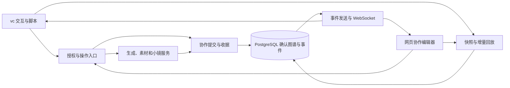

# 全功能 CLI 画布实时协作技术设计

适用范围与角色见[CLI 协作规格](01-CLI协作规格.md)。服务端图谱、版本、任务和权限以现有[协作技术设计](技术设计.md)为基础。

## 架构与接口



在 `cli/` 增加会话、类型化计划、本地运行记录、协作客户端和命令适配。Go 暴露普通协作接口的授权数据、操作收据和必要的受限入口。网页和 CLI 共用字段、结构验证、任务回填以及图谱持久化。使用现有 PostgreSQL 事务排序和事件通知，CLI 特性开关可单独灰度。

| 路径 | 设计 |
| --- | --- |
| 能力发现 | 增加版本化的能力元数据，返回协议版本、节点/动作支持、当前批次和媒体限制、可授权范围。画布角色和任务权限仍以该画布的已授权响应为准。旧站点明确不支持协作命令时，既有个人画布命令继续走个人路径。识别到协作会话后始终使用协作入口。 |
| 发现和读取 | 复用个人列表和 `/canvas/shared`。活跃画布读取 `/canvas/:id/collaboration`，未启用协作的查看者由只读共享入口提供数据。单节点筛选和只读图谱可优先复用快照，超大图谱按需提供已授权的记录投影。 |
| 基础图谱提交 | 复用 `/canvas/:id/collaboration/ops`、`undo` 和现有事件链路。计划的类型化动作通过统一映射转换为允许的协作变更。缺少标题、精确 undo 或结构命令时，扩展服务端明确动作与事件协议。 |
| 持续监听 | 复用 `/ws/ticket`、WebSocket 房间通知及 `/canvas/:id/collaboration/events`。补轻量的授权版本水位和必要的事件类别，CLI 能独立追赶。媒体走普通授权下载入口或按项目授权签发的短期凭证。 |
| 评论回放 | `/canvas/:id/collaboration/comments/events` 按当前编辑权限和代数读取。首次省略 `after` 仅获取水位，`after=0` 从首条可见评论开始，后续使用响应中的不透明游标。`canvas.comment_changed` 仅唤醒所有者和编辑者。CLI 在图谱回放后读取评论，收到通知或到达轮询周期时追赶。已删除节点的评论不投影，仍推进扫描游标。 |
| 补齐契约 | 增加只查询已认证调用者的操作收据、计划执行预算和自动化授权。补齐 CLI 可提交的成片组合与角色图后续音色编排。优先复用已存在的会话管理、拆镜、生成、素材上传、收藏与共享交付路由。 |

## 计划、冲突与事务

计划有独立的 `schemaVersion`，保存站点、账号标识、`canvasId`、`epoch`、用户读到的 `baseRevision`、操作类型与稳定 ID。状态、结果和素材引用由类型化动作表达。临时别名在批次内解析成稳定 ID，未提交前明确引用是否跨批。覆盖旧字段基于实际读到的前置版本。现有快照提供图谱与确认版本，粗粒度计划可使用该 `baseRevision`，细粒度计划使用服务端确认的对应记录或字段版本。

单次交互命令先取到确认版本再展示计划。脚本可用生成好的计划执行。计划只针对同一站点、账号、画布和协作代数。`apply` 沿用操作者实际观察到的字段基线，在已证明输入等价或变更互不相干时自动继续。重叠更改显示旧值、队友的当前值和本次预期值。用户或脚本依据新的确认视图显式生成新操作。

节点树、连线、分镜顺序和活动结果都在提交事务内按现有图语义复核。不同镜头、角色属性和场景对象使用稳定 ID，复用现有结构化字段规则。重排操作检查相邻项和集合版本，禁止从过期整个数组覆盖队友修改。主结果选择检查目标产物与节点的当前关联。精确个人撤销在现有撤销入口增加预期目标检查，目标已变化时提示重读。撤销仍保留已被队友更新的字段，返回实际变更和跳过项。

镜头与导演台对象写入在同一个画布事务内解析稳定 ID，并与字段版本比较。镜头数字位置依赖整张表的顺序版本。写入确认、回放和快照沿用 `data.storyboard` 与 `data.scene`，网页可以直接消费。自动拆分镜与网页整字段提交在保存时也更新子项版本。对象操作不接收媒体地址，保留原有媒体投影。

每个原子批次当前最多 **100 条记录变更**，HTTP 接收上限为 **1 MiB**，仓储另有 **256 KiB** 的编码后提交体上限。CLI 校验应使用服务实际支持的最严格限制，并通过能力发现取得当前值。对于大型导入，先编排显式独立的批次，用稳定 ID 串联依赖。前置批次发生冲突时，依赖它的批次暂停，独立批次可继续。超出限制的单个原子操作应给出服务可接受的做法或返回适用版本信息。 [记录数校验](../../../backend/internal/repository/canvas_collaboration_fields.go) · [编码后上限](../../../backend/internal/repository/canvas_collaboration_commit.go) · [HTTP 上限](../../../backend/internal/handler/canvas_collaboration.go)

## 失败恢复与实时读取

生成进度复用 `canvas.generation_progress`。CLI 仅输出当前画布、代数和已确认节点运行对应的 `generation-progress`，只含节点 ID、运行版本和百分比。同一运行的进度合并，样本过期、连接关闭或权限变化时清理。最终状态通过图谱确认事件回放。

- CLI 在网络调用前写入本地运行记录，持久化原始规范化载荷、`epoch`、`opId` 或任务幂等键、计划摘要和过期时间。使用用户私有目录和原子文件替换，同一运行记录按文件锁更新。默认无需长期存图谱或媒体文件。恢复文件中避免写入 token、签名地址、供应商密钥和任务原始响应。必要的请求体由严格权限保护，状态输出可只给摘要。若系统无法提供安全存储，交互模式允许只保留操作 ID 并提示手工对账。
- 使用当前身份读取收据。原始请求在同一账号、画布和代数内重发时保持原 ID 和载荷。相同 ID 的不同载荷是协议错误。操作收据在写入事务内持久化，推送或客户端投影失败时按收据确认。确认后的冲突同样保留收据。事务只在通过当前权限和提交规则后生效。
- 恢复窗口建议沿用协作草稿的 24 小时。服务端保留足够久的收据，并检查恢复记录对应的计划有效期。高影响或付费计划由服务端确定开始时间和有效范围。收到明确过期或无法证明是否已提交时保留操作编号供对账，禁止自动换键补发。恢复成功前保持 `unknown`、`confirmed`、`conflicted` 或 `rejected` 等明确结果。
- `watch` 先订阅并缓冲最高通知水位，再载入快照或补拉从游标起的增量。游标包含画布和 `epoch`，只应用连续版本。完整被裁剪的版本也推进游标。收到重复通知合并水位后处理。周期性水位检查处理末尾丢通知，断线按带抖动的退避恢复。收到 `snapshotRequired` 时用已授权快照重建和校验。
- 浏览器和 CLI 的可靠事件优先于在线状态。默认监听表示终端在线，成员列表同账号合并。`--follow` 仅在显式开启时显示目标成员授权视角。超量慢读者断开后按游标追赶。权限降低时停止相应写入和读取，撤权时退订、清理授权缓存、已绑定的待提交计划和临时媒体凭证。先前已下载的数据受操作系统与数据管理规则约束。
- CLI 通过 `canvas.attendance` 每两秒发布一次仅包含代数的心跳。服务端校验房间读取权限并附加用户身份。网页继续以 `canvas.presence` 发布选区和视角，两个状态分别过期。CLI 将同账号合并为一名成员，`--follow` 每 250 ms 采样有变化的视角。快照和已确认变更驱动回放游标。

## 任务、素材与权限边界

### 付费生成与小镜

生成计划固定已确认的节点、来源版本、实际输入、模型、候选数和预算上限。预检显示估价与参数限制。任务受理时校验价格变化和余额，绑定服务端生成输入快照，使用原有生成授权及额度。批量预算以运行记录聚合已经预留和结算的金额。多个后端实例通过同一个持久化预算控制保证并行消费不超限。逐项受理可成功或失败，CLI 输出已受理的任务 ID 和幂等键，剩余项目可以按预检规则继续。

`--budget-key` 和 `--budget-credits` 选择账号、画布及当前代数下的累计预算。首次受理固定预算金额。普通生成和拆分镜在各自的受理事务中锁定同一个预算记录并检查用量。普通生成统计在途冻结与积分流水结算额，拆分镜统计在途请求上限与终态实际费用。当站点能力清单未声明累计预算时，CLI 在确认输入前拒绝请求。

任务受理幂等以发起人、原计划及逐项意图为边界。写入任务、触发入队和计费需要复用既有事务或持久化重试流程。调用供应商、入队和存储失败时区分已受理、待派发、失败和待补偿状态。终态后按现有账本做幂等结算或退款，节点更新复核当前会话、授权、任务和目标绑定。旧任务或失效的素材只走应有的账务和清理流程。主结果选择独立提交，异步写回不会替用户选中的有效结果。

自动拆分镜的追加与覆盖固定各自输入和结构版本，覆盖需要预览及确认。组合角色形象与音色使用持久化的续接步骤，音色步骤关联形象任务和已确认角色，沿用模型与预算控制。网页和 CLI 可以观察同一个已受理任务。小镜启动提交现有 `collaboration_epoch` 与已确认的上下文。审批、生成、回填与撤销由服务端重新检查适当的角色、授权和会话。保留节点健康状态、用户可见摘要和任务所有者的私有明细投影。取消等待只终止本地监听，取消任务调用已有取消能力。

### 素材加工和成片

对可在本机执行的图片标注、宫格、抽帧和修剪，约定可复现的输入坐标、时间单位、资源限制和工具能力。CLI 使用受支持的运行时或站点媒体处理服务，根据能力发现选定路径并在预览中明确。付费扩图、人声分离走现有模型任务。成片在可授权的任务后端生成，固定输入素材、顺序、编码参数和版本。它需要补齐可在终端调用的导出任务契约，完整上线前通过真实编解码与媒体文件测试。

加工先读取有权访问的源节点、素材版本和用途。上传产物使用账号拥有的暂存对象，挂载时再次校验源、目标、授权与产物归属，事务内确认节点、来源连线和资源引用。加工耗时与对象复制在锁外完成，提交阶段只处理最终校验和引用确认。每个宫格产物可作为显式独立项目确认，发生失败时给出格子、来源和暂存状态。临时对象使用到期清理与补偿任务。收藏到个人资产库复用独立的收藏授权和归属规则。长期对象键及其他人的个人资产信息经服务端投影。

暂存记录由画布、操作者账号和操作编号共同索引。上传按内容哈希识别同编号重试。暂存记录一小时到期，清理任务按存储键和到期状态声明回收，再在事务外删除对象。挂载在画布事务中锁定暂存记录，提交所有者素材、图谱变更和包含来源素材及版本的收据。

成片任务按画布、发起账号和操作编号识别重试。服务端在同一事务内保存观察版本、有序节点与生效素材，并写入 River 队列。任务支持 1–24 段视频，输入合计最多 512 MiB。首版输出采用首段分辨率、30 fps、H.264/AAC MP4。Worker 在取素材与发布产物前分别核对权限、代数和来源绑定。成品素材、派生节点、来源连线与任务成功状态同时提交。取消通过相同的画布锁与最终发布排序。`task get/wait/cancel` 通过画布与代数定位发起者可操作的任务。

共享交付在预检和最终事务中检查当前协作代数内在途的成片任务。任务取消或进入终态后解除该限制。

拆分镜和角色音色共享摘要只读取当前协作代数内仍有节点关联的任务，按活跃状态和更新时间排序，每次最多返回 100 条。摘要不读取脚本、提示词、账单、供应商数据或错误原文。`watch --tasks` 以至少五秒的间隔对账，内容变化后输出列表。

### 人员、自动化和高影响操作

交互使用现有设备登录和网页的授权约定。无人值守发放显式批准、可过期和可吊销的受限凭据，绑定站点、账号、画布和动作范围，付费另限额度。只开放必要的服务端入口并拒绝凭据借旧接口扩大权限。审计中的身份由服务端解析，显示用户名和操作来源。网页、CLI 和队列统一复核当前成员角色，写入时在事务内核对，防止排队请求在撤权后获得新写入资格。

付费 `generate` 凭据签发时绑定固定积分额度。站点在画布事务中从数据库重读凭据并确定预算组，按已冻结与已结算积分核算可用额度。任务的幂等键和查询权限按凭据隔离。队列沿生成任务契约结算并释放未使用额度。终端每次提交仍须指定 `--max-credits`。

当前专用凭据有效期为 1–168 小时。服务端保存密钥哈希和签发时的账号令牌版本，并校验当前画布代数与成员角色。编辑者降权或离开时撤销已有凭据。`read` 支持快照、授权回放与操作收据，`edit` 增加普通图谱编辑。分镜和导演台通过子项编辑变更现有内容。凭据暂未开放付费任务、删除、整表覆盖和管理接口。

删除、归档、模式切换、退出、转移、共享副本和角色授予预览确切目标、受影响对象以及在途任务。交互确认绑定站点、账号、目标 ID、相关版本和影响摘要。确认期出现影响范围变化时重新展示。自动化可以执行授权范围内的一般结构化编辑，涉及管理和交付的高影响操作由现有交互确认或其显式批准记录处理。转移成功后仅允许原发起者按原交付标识取得最小交付收据，原画布和媒体按权限退役。

归档预览由所有者读取，返回标题、版本、编辑者和查看者人数及预览指纹。归档事务锁定画布，复核版本、成员身份和角色，再检查在途生成、拆分镜与成片任务。重命名生成连续版本事件，回放响应携带已确认标题，网页和 CLI 追赶到该响应的版本后应用标题。

## 脚本契约

既有 `--json` 保留单行 `{ok,data}` 或 `{ok,error}`。协作命令使用字符串传输 ID 和版本，接收现有整数协议时使用无损解析。`watch --jsonl` 逐行输出，包含 `schemaVersion`、事件 `type`、`canvasId`、`epoch`、`revision` 和有权可见的 `data`。机器结果保持在 stdout，提示和诊断写 stderr。文件导出与 JSON 流使用各自明确的输出方式。

当前 CLI 无损读取 HTTP 和 WebSocket 的整数版本。超出安全整数范围的值以十进制字符串保存在计划与脚本结果中，向现有 Go 接口提交时写入精确的 JSON 整数。增量连续性、进度和历史位置按整数值校验。`watch --jsonl` 外层的代数和版本始终为字符串。

网页在 HTTP、WebSocket 和本地协作草稿中保留相同的十进制表示，写入时只编码协议版本字段。小镜通过 Go 平台头传递精确代数，在 SQLite 中以可无损读取的文本保存大代数。旧数据中的安全整数继续可读。

提交结果有 `opId`、`epoch`、确认版本、各项结果、可见冲突、可用的收据信息和任务句柄。错误使用服务端已稳定的 `code`，并提供跨客户端归一的 `reason` 和结构化详情。`reason` 的拟定取值包括 `conflict`、`permission_denied`、`epoch_expired`、`plan_expired`、`result_unknown`、`rate_limited`、`partial` 和 `unsupported`。结果未知携带原 ID。限流带服务端的等待建议。冲突字段与私有任务输入按当前授权裁剪。

建议协作命令沿用现有 `0` 成功、`1` 业务或网络错误、`2` 用法错误、`3` 等待超时、`4` 用户取消。结构化 `reason` 用于区分冲突、部分成功和重试条件。新协作命令保留逐项结果，部分成功默认退出 `1`。现有命令在个人画布的行为按 CLI 契约测试。 [现有退出码](../../../cli/README.md)

## 关键分支

```text
B01-01 解析站点、主体、画布模式及授权。按角色选择列表、快照或读取失败。
B01-02 监听订阅后按确认游标回放。检测到代数变化、缺口或撤权时刷新或结束。
B01-03 同一画布事务排序。按字段、结构、生成绑定和目标记录版本检查完整的批次。
B01-04 处理未知结果。检查会话并读取原收据，依据请求摘要识别合法重试和误用。
B01-05 核验媒体来源和对象归属。提交引用前复核授权，未挂载暂存对象进入回收。
B01-06 付费任务检查预算和已确认输入，使用持久化任务意图结算并按绑定回填。
B01-07 拆镜、组合音色和小镜按各自任务状态续接并复核画布权限。
B01-08 检查高影响操作确认内容及当前版本，提交交付或拒绝并展示新影响。
B01-09 受限凭据校验画布、动作、到期和吊销状态，按协议输出结构化结果。
B01-10 调用入口限流和后端任务并发。队列已满返回退避建议，慢订阅端按游标补拉。
```

### 分支到测试追踪

| 分支 | 场景 | 验收标准 |
| --- | --- | --- |
| B01-01 | 所有者、编辑者、查看者及协作与个人画布切换 | AC01 |
| B01-02 | 重复通知、补拉、权限降级和收敛 | AC02 |
| B01-03 | 独立字段、热点字段、结构级联与部分成功 | AC03 |
| B01-04 | 已提交后丢响应、权限变化、重复或过期收据 | AC04 |
| B01-05 | 媒体暂存失败、并行替换和在途撤权 | AC05 |
| B01-06 | 预算竞争、重复任务、已选版本与终态回填 | AC06 |
| B01-07 | 拆分镜覆盖、组合音色续接、小镜重复审批 | AC07 |
| B01-08 | 交付冲突、版本变化、转移后收据与撤权 | AC08 |
| B01-09 | 无人值守越界、令牌吊销、输出契约 | AC09 |
| B01-10 | CLI 突发、网页正常编辑、慢监听和故障恢复 | AC10 |

## 效能、灰度与回滚

单画布 CLI 写入以短事务和小批次运行。压测可从每账号每画布每秒 2 个编辑批次开始，限制值以实测为准。服务端对同一账号、同一画布和同一 Token 的并行命令设必要的公平限制，各实例共用相同预算。编辑、生成与媒体吞吐分别测量，给网页常规编辑和权限操作留容量。采用已有队列的优先级和容量边界。日志按操作 ID、画布、延迟、恢复与归属记录摘要。

| 验收维度 | 方法与目标 |
| --- | --- |
| 环境 | 双 Go 实例、PostgreSQL、Redis 和实际 `vc` 进程。纯 CLI 组分别使用 4 和 8 个进程。混合组使用 4 个 `vc` 进程和 4 个运行实际画布页面的独立浏览器会话，每个客户端使用独立测试账号。每组对约 1,000 节点的松散、边密集、长文本和多媒体引用样本模拟 80 ms RTT。 |
| 延迟 | 沿用协作指标，健康网络下从发送方提交开始到接收端应用确认版本的 P95 ≤ 300 ms。明确记录媒体处理、模型排队、CLI 本地等待和远端应用各自的起止点，前两项单独报告。每组每个关键操作至少采集 100 个可比较样本。 |
| 持续吞吐 | 4 CLI + 4 真实网页混合组连续运行 30 分钟，期间并行编辑、批量提交和注入故障，恢复后继续写入。记录事务锁等待、每批 WAL、推送和追赶数据量、冲突率、限流、同画布网页延迟及最老任务等待时间。暂停流量后确认队列回落，正常接收者不被慢连接阻塞，所有投影收敛到同一已确认版本。 |
| 故障与正确性 | 跨实例重启、丢响应、缓存降级、并发撤权、在途交付和生成重试。独立编辑结果全部保留，同场景的已授权投影收敛到同一确认版本。要求零静默覆盖、零部分提交的原子批次、零重复付费与零越权副作用。 |
| 可用性 | Windows、macOS 与 Linux 验证设备授权、终端确认、计划文件权限、UTF-8、Ctrl+C 恢复、脚本 JSON 和至少一次真实媒体工作流。依赖模型或媒体处理的能力以测试服务与一轮真实测试站点验证记录为准。 |

混合验收使用 `backend/internal/tests/repository/canvas_mixed_load_test.go` 与 `scripts/canvas-mixed-browser.mjs`。先构建 CLI 和网页，构建网页时设置 `VITE_API_BASE_URL=/api/v1`。在隔离环境设置 `TEST_DATABASE_DSN`、`TEST_REDIS_ADDR`、`TEST_CANVAS_CHROME` 与 `TEST_CANVAS_MIXED_LOAD=1`，然后在 `backend` 运行 `go test ./internal/tests/repository -run '^TestCanvasMixedRealClients$' -timeout 35m -v -count=1`。`TEST_CANVAS_MIXED_SMOKE=1` 仅用于 25 秒快速核对。用相同环境单独运行 `TestCanvasMixedLargeVersions` 可验证网页和 CLI 越过 JavaScript 安全整数上限后仍能协作。网页从 CDP 捕获提交时间，在远端实际渲染对应节点标题时记录应用时间。脚本同时报告包含编辑动作的时长，便于区分应用交互与同步延迟。

按站点和画布开放 CLI 协作能力。出现授权、丢写、账务或延迟回归时关闭对应 CLI 写入口或能力组，读取保证重新验证权限，已受理任务继续按原工作流对账。对主动关闭画布协作的操作沿用会话换代及退役规则。发布记录覆盖兼容版本、落地迁移、负载结果与回滚验证。 [现有发布指标](产品方案.md#发布指标)
