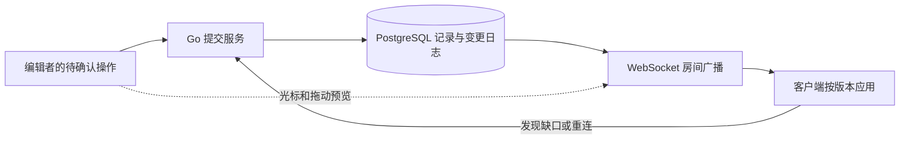

# 画布实时协作技术设计

评审稿。权限及阶段范围见[产品方案](产品方案.md)。

## 选型与现状

| 参考 | 可复用的思路 | 在本项目的用法 |
| --- | --- | --- |
| [Figma 多人编辑技术](https://www.figma.com/blog/how-figmas-multiplayer-technology-works/) | 中心服务排序，以对象和属性为粒度同步 | 为节点位置、提示词和生成结果定义独立的字段边界。按字段版本识别冲突。 |
| [tldraw sync](https://tldraw.dev/docs/sync) | 每个文档一个协作房间，使用 WebSocket 连接客户端，保存可恢复的房间状态 | 将画布作为订阅单位，持久化内容，单独传递实时在线状态。复用 React Flow 和当前 Go 服务。 |
| [Yjs 的共享文本](https://docs.yjs.dev/api/shared-types/y.text)与[选择性撤销](https://docs.yjs.dev/api/undo-manager) | 文本可按细粒度合并，撤销可限定改动来源 | 当同一段提示词需要多人同时输入时，在明确的文本字段内引入 CRDT。由服务端鉴权并持久化文本更新，同步到生成所用的确认快照。 |

现有画布已具备 [`revision` 乐观锁](../../../backend/internal/repository/canvas_project.go)、[节点级操作](../../../backend/internal/service/canvas_ops.go)、[用户频道补丁](../../../backend/internal/service/canvas_write.go)和[独立的生成回填](../../../backend/internal/service/canvas_node_backfill.go)。这些是可复用的基础。协作需要一个按画布授权和排序的提交入口，以及可重放的变更记录。协作层优先沿用 Go、PostgreSQL 和既有 WebSocket 基础设施。

## 内容、在线状态与视角

| 数据 | 提交与传播 | 生命周期 |
| --- | --- | --- |
| 节点、分组、连线、提示词、结果 | 语义操作批次经服务端校验后写入 PostgreSQL，通过 WebSocket 通知房间成员 | 快照持久化，变更日志可补发 |
| 在线成员、光标、选区、拖动预览 | 经鉴权的房间临时消息，可用 Redis 做跨实例分发和在线状态 TTL | 可丢弃、可限流。断开或超时后移除 |
| 视角、缩放、展开与播放器进度 | 客户端或用户偏好存储。跟随时由用户开启临时接收 | 个人状态 |

首版写入走已登录的 HTTP 请求，接收提交结果并在房间内分发。HTTP 响应与 WS 事件可能任一先到，客户端根据 `opId` 和 `revision` 合并。WS 支持在线状态和订阅；房间消息慢时丢弃过时的光标或移动预览，内容事件由版本追赶恢复。



## 写协议与一致性

- 一个批次包含画布 ID、协作会话代数、客户端 `opId`、`baseRevision` 和带前置条件的语义操作列表。节点 ID 稳定，字段组有各自最近变更版本。位置坐标一起更新，状态和媒体结果由服务端拥有。数组按业务键定义独立条目或原子字段组，具体由节点字段策略登记。
- 在画布事务内按固定顺序锁定画布和成员授权，校验画布代数、当前角色和请求体。验完重复请求并检查前置条件后，应用操作、更新受影响记录和字段版本、写操作收据及可发布的变更记录。一个批次要么完整确认，要么得到冲突明细。无变化时登记收据并返回当前版本。语法校验和纯计算可在事务外完成，依赖当前数据的判断在事务内重新校验。
- 变更记录承担事务性发件箱。提交后由派发器推送，派发失败可重试。至少一次分发由客户端按版本去重。Redis 用于即时通知，PostgreSQL 提供已确认内容、回放与对账依据。
- 幂等键为 `(canvasId, actorId, opId)`，同时保存请求摘要。同一键同一内容返回原收据，不同内容拒绝。去重收据和删除墓碑至少覆盖客户端可重试窗口。内测可从最长 24 小时短线恢复、至少 7 天收据和变更留存开始，按容量调整。过期队列重新拉取会话后由用户选择如何应用。
- 所有增量必须经同一个版本序列。协作画布开启前登记整图保存、CLI 操作、Agent 写入、生成回填和删除/交付等入口。逐一接入统一提交协议，或在服务端为协作画布拒绝该入口。编辑器旧版整图写入在启用后返回升级或切换提示。个人画布按现有入口编辑。

| 写入入口 | 活跃协作画布的处理 |
| --- | --- |
| 浏览器协作工作台 | 节点、边、组、主结果及个人撤销经授权事务，提交后推进统一版本。 |
| 旧客户端整图保存、CLI 节点操作、Agent 读改写 | 画布服务拒绝旧写入并返回切换到实时协作入口的提示。个人画布保留原有流程。 |
| 生成任务与素材导入 | 绑定协作代数、当前授权和节点输入或生成版本。素材与变更在事务中登记，由统一版本回放。 |
| 删除、复制、所有权转移及回滚 | 活跃画布的旧删除入口受保护。复制和转移使用确认版本，转移复核任务与权限后退役原画布。关闭协作时物化最后确认快照。 |

### 活跃画布的存储

面向约 1,000 节点的首版内测，采用按节点、边、分组拆分的记录作为协作画布的写入来源。节点配置可保留为节点内 JSON，体积较大的生成历史可按结果单独存放。每批仅更新触及的记录和画布 `revision`，并原子写入变更事件。变更表对 `(canvasId, revision)` 建唯一约束，媒体通过独立存储和受保护的引用访问。

个人画布进入协作模式时，在画布写入边界内从已提交版本校验连线和分组，再初始化记录并切换模式。结构校验失败时事务回退，所有者可以在个人画布中修正后重新开启。快照由同一事务视图内的记录和 `revision` 组装，可按确认版本缓存或异步建立检查点。副本、转移和导出从指定确认版本读取。退出协作模式时，先在写入边界内从最后确认版本物化完整图，再切换读取方式并使旧会话失效。两种表示的源数据归属由模式决定。

所有者可从协作工作台顶栏导出画布。客户端先同步本地修改，再将确认版本和会话代数传给导出接口。后端在同一事务视图中校验当前所有者并读取指定版本。指定版本不可用时提示刷新重试。接口参数及兼容规则见[画布导入导出](../画布导入导出/画布导入导出.md#83-接口提案)。

版本活动仅向当前所有者和编辑成员提供作者、版本和变更对象。当前所有者可预览历史正文，并按稳定的操作编号另存为个人画布。恢复时移除旧任务绑定。开启时、每到 24 的倍数版本以及变更正文达到 128 KiB 时，同事务保存确认检查点。历史查询从目标版本最近的检查点开始，回放受条数与字节预算限制。后台分批清理超过 30 天的历史，保留活跃代数的检查点锚点、待派发事件与幂等收据。Chrome 验证了历史预览加载真实图片，以及模拟资源不可用时保留节点并显示占位提示。

**本地存储微基准**。隔离 PostgreSQL 16.16，1,000 个合成节点，整图 JSON 文本约 1.06 MB。每笔事务改一个节点字段、推进版本并写一个变更事件。预热后交错运行，每组 40 笔串行提交，每组前执行 `CHECKPOINT`。整图 `jsonb_set` 两次耗时 939–1,041 ms，产生约 48.78 MB WAL。拆分记录两次耗时 40–50 ms，产生约 0.23–0.38 MB WAL。样本提示词由难压缩的合成数据构成。这组结果用于确认写放大的方向，真实画布上还需用不同可压缩性、热点争用和数据盘条件验证收益、快照成本及迁移成本。

### 交互与分发成本

- 指针、拖动预览和任务进度采用按对象覆盖的临时消息。前台试用初值为每人每秒 10–15 次临时更新，手势结束提交一次最终坐标。低端设备或网络积压时优先降低预览频率。独立输入小批量合并，默认以约 100 ms 为采样起点。失焦、提交与输入法确认立即处理当前编辑边界，避免提交拼音中间态。
- 本地编辑先应用到当前界面。远端补丁按节点 ID 更新，未变更记录保留引用，图谱投影复用当前视图的测量尺寸。远端光标、选区和拖动预览用独立渲染层消费临时状态。协作编辑器在至少 200 个节点时按视口渲染，完整节点及连线保留在图谱中。保留测量尺寸可避免应用增量后，视口外节点为重新测量而成批挂载。
- 每连接设置字节和批次上限，优先发送权限控制和内容确认。临时状态积压时合并为最新状态。内容积压超过上限时停止继续投递，要求客户端按最后确认版本追赶，或在无法发出恢复指令时关闭连接。恢复扫描时携带可见版本水位和限量游标。若某一版本对接收方无可见改动，用已验证的版本水位推进连续性。

  WebSocket 默认允许每连接排队 64 条消息和 16 MiB 消息正文。在线状态按房间订阅与成员合并，生成进度按房间订阅与节点合并。临时队列最多占消息数上限的一半。可靠消息优先发出，入队时可移除临时消息释放空间。可靠消息仍超限时关闭连接，由客户端重连追赶。退订立即清除对应订阅的待发消息。
- 版本补发按数量和字节双重分页。补丁成本接近整图或日志已越过保留窗口时，切换到同一权限范围的快照。多标签页各自保有会话和编辑队列，线上成员按账户聚合，降低重复光标和名录抖动。

### 并发与撤销

| 场景 | 判定 |
| --- | --- |
| 两个人改不同字段 | 相关字段自 `baseRevision` 以来未被写过，可基于最新图应用 |
| 两个人改同一字段 | 若意图的值已与当前值一致，返回已应用。不同值按第一个确认的写入处理。另一端收到字段级冲突、当前值和版本，可比较共同起点、最新值与自己的草稿后提交 |
| 删除、分组、连线 | 节点删除检查目标及关联结构版本，移除关联边并留墓碑。连线端点须存在。分组检查父子关系和循环。已删除对象的旧 ID 不能被重放恢复 |
| 撤销 | 使用操作的逆操作和操作后字段版本。服务端只回退仍匹配的字段并报告跳过项。还原删除需单独校验引用、权限和 ID 重建，首版可将破坏性删除交给后续版本历史恢复 |

当另一位成员在 `baseRevision` 之后连接了同一对节点，后提交的连线批次收到包含已确认连线 ID 和版本的冲突收据。整批改动留在草稿中。重新应用时，若已确认的连线与草稿的端点和端口相同，保留该连线并重新提交其余改动。已知当前连线时重复创建仍按无效操作处理。

前序编辑的收据和发起者的增量回放记录服务端修改前的 `previousRevision`。只有该版本在待提交删除的确认范围内，客户端才推进同一记录的 `recordBase`。确认创建后，也可以推进对该对象的后续删除。级联删除涉及的连线继续按原批次版本校验，同一批次的其他记录沿用各自的前置版本。

连续撤销通过逆操作记录恢复值所属的编辑版本。在该值仍有效时，可以继续撤销上一笔个人编辑。普通写入和断线重放仍按单调递增的字段版本校验。缺少来源版本的历史逆操作仍按原字段版本判断。

撤销创建时，服务端确认对象仍对应原创建操作，所有字段当前的来源版本均未晚于创建版本，且没有现存连线或子项引用该对象。同一笔撤销会先应用可恢复的字段，再检查剩余引用。若对象仍保留后续编辑或引用，返回跳过项。

### 加入、断线与跨实例恢复

加入房间时先验证成员角色并登记订阅，以确定的服务器版本读取快照或增量。初始化期间缓存或后续补取更新，客户端只确认连续的 `revision`。断线或收到缺口时从最后确认版本补取，保留期外使用快照。会话期间通过轻量级版本水位对账，覆盖末尾通知丢失。快照、补丁和收据只能按接收者的当前权限取回。

增量事件仅包含接收者有权读取的改动。若某一版本只更新了其他成员不可见的生成输入，事件保留版本号，客户端确认该版本时保留图谱引用。冲突收据的版本高于客户端确认版本时，先补齐授权增量或读取快照，再显示冲突草稿，避免用户重新应用时仍基于旧版本提交。

编辑端单轮最多回放 16 页，实时只读端最多 10 页。若还有下一页，客户端累计已收到的事件 JSON 字节，并以本轮开始时的确认图谱 JSON 字节数估算快照成本。预算取确认图谱估算值的 80% 与 16 KiB 中的较大值，避免小画布的少量增量过早触发快照。超过页数或字节预算后，走当前角色的授权快照接口。若最后一页已补齐版本，则直接使用增量。编辑端取得快照后再重提草稿，等待快照期间产生的编辑沿用编辑者实际看到的版本进行冲突检查。

客户端保留「已确认画布 + 本地待确认操作」，远端事件先更新确认状态，再重放仍合法的本地操作。重连先校验授权和协作代数，再发送原操作 ID。每条待确认操作登记其因果依赖。前序操作进入冲突处理时，将依赖它的操作一并暂停，其他独立编辑可继续同步。首次提交后固定请求正文和操作 ID，避免断线重试时以同一个 ID 发送不同内容。短时草稿按用户、画布、会话代数保存在本机，权限仍有效时可留存冲突草稿供比较。撤权或退出时清理本地数据，不可恢复的数据过期后删除。顶栏的保存状态根据服务端确认推进。

服务端明确以 HTTP 400 和业务码 `10001` 拒绝编辑批次时，将该批次和依赖它的草稿移入协作冲突面板。该批次暂停自动重试，独立编辑继续提交。成员可在面板保留当前确认内容，或按当前确认版本重新应用草稿。

待确认的个人撤销与编辑草稿共用同一隔离范围。重新进入时主动对账，先补齐当前授权版本，再携带原操作 ID 重提可同步的编辑或请求撤销收据。若进入时已经失去生成授权，则先清除待确认的生成输入。确认、降为只读、撤权或超过 24 小时后清理待确认的撤销请求。服务端复核收据的会话代数，同一操作 ID 不能在另一代会话中取得旧收据。

## 权限、媒体与费用

### 创作节点增量与资产入口

- 画布添加菜单、右键菜单和工具栏共用个人画布的节点类型、上传与资产选择。点击选择的资产与上传成功的文件沿用画布节点导入协议。
- `data.storyboard`、`data.scene`、`data.character` 分别作为单个字段确认，匹配对应节点类型。修改位置、标题等独立字段可以合并。同一复杂字段遇到并发修改时交由现有冲突面板处理。分镜镜头顺序与节点引用随分镜表一同确认。
- 导演台在没有待写入场景时应用远端内容。编辑中的场景保留起始确认版本，延迟上传的缩略图只绑定到对应场景。协作操作请求上限为 1 MiB，单个复杂字段上限为 512 KiB，导演台前端继续执行自身的场景大小上限。
- 结构化补丁只提交素材 ID。角色补充图、音色、导演台缩略图和已有分镜图都按指定媒体类型校验并随操作落库。在同一事务中确认素材绑定、节点增量与版本。浏览器提交的源地址不会写入记录。确认、冲突返回、回放、快照与撤销按当前接收方权限派生地址。
- 图片节点和角色卡主图可由资产库换图。新素材由服务器追加为历史结果，仍可切回原图。导入对主结果、历史及展示字段进行成组更新和撤销。

### 创作任务接入

- 自动拆分镜绑定已确认的剧本、追加或覆盖模式、节点和会话代数。提交和入队同事务，运行前复核权限，结算时再验证会话和节点绑定。协作版号、分镜结果、任务终态和扣费同事务提交。追加以结算时的分镜为基准。覆盖遇到分镜字段的更高版号时拒绝，任务失败并清除运行标记。队列尝试序号防止恢复前的执行重复结算。协作事件通过持久化派发与回放同步。
- 角色 AI 音色沿用 `voice:<节点ID>` 绑定和发起者计费。生成成功时，服务端将新音频写入 `data.character.voice`，保留角色卡的其他字段。成员音频产物沿用现有素材副本和画布范围授权。组合动作「含音色」由浏览器在确认对应形象后发起，续接使用同一形象任务的幂等键。关闭时清除节点上的协作任务状态，导出不携带这些运行字段。
- 小镜入口仅对拥有生成权限的编辑者和所有者开放。发送消息前同步本地编辑。运行保存会话代数，同一协作画布内按成员和代数互斥，个人画布仍按画布互斥。平台在模型、工具和审批入口校验当前权限。小镜修改使用协作事务和回放，节点创建撤销使用服务器确认过的字段。批准的生成任务以审批条目去重，复用发起者计费和协作产物回填。

### 协作权限与计费

- 成员权限集中在画布成员关系和协作代数，沿用所有者唯一归属。订阅、快照、追赶、修改、在线状态和媒体读取都校验角色。复用现有已登录 WS 票据机制，房间名不能授予权限。共享查看者使用授权投影，编辑成员收到的补丁也只包含共享可见字段和受保护媒体引用。
- 新建或填充空媒体节点时，客户端提交素材 ID。持久化事务验证素材归属、当前画布引用和媒体类型，并派生地址与展示字段。成员导入个人素材时先暂存独立对象，在相同事务内登记到画布所有者名下。成员的确认和回放使用画布范围内的媒体地址。填充的媒体字段作为一组撤销，后续生成改动触及该组时保留结果。
- 媒体加工上传成功后才把素材节点及其来源连线一起纳入协作比较。发起者在增量重绘时保留尚未同步的上传进度或失败状态，各宫格独立提交和重试。
- 成员收藏使用独立的可撤销授权。预检当前会话、成员、节点主素材与目标文件夹后，复用交付暂存复制对象。确认事务锁定画布，复核授权、源存储身份和节点引用，并锁定目标文件夹。在同一事务中登记素材及个人库条目。用户与源素材的唯一约束避免并发重复收藏，剩余暂存对象由交付清理回收。
- 撤权与写事务采用一致的锁顺序。权限事件传播后关闭或切换会话，跨实例使用版本化的授权状态与短时校验窗口补偿通知丢失。对内容发送校验当前授权，撤权时丢弃服务器待发送队列中的受保护内容。撤权后的新请求必须被拒绝，已交付到设备的数据不具备远程收回能力。
  服务器收到权限变更通知时清空房间在线状态的授权缓存，并更新订阅的鉴权版本。已开始的检查返回后须核对订阅和鉴权版本，避免把变更前的结果重新写入缓存或用于分发。
- 首版所有者生成使用当前计费链路。服务端任务绑定画布、节点、任务 ID、节点生成代数，以及启动时的提示词和模型参数。终态回填只更新匹配代数的任务字段和结果历史。后发任务、已删除节点、内容退役或被取消的情况下按幂等结果记账并跳过不合法的节点写入。
- 发起生成前把该节点相关的本地编辑推进到已确认状态。提交携带节点输入版本或摘要，由服务端原子确认所用模型、提示词和素材引用。版本变化时显示最新参数并要求重新发起。任务进度以临时状态分发，结算和终态回填走持久化链路。需要对比两种方案时，按任务 ID 展示各自产物，切换主结果由用户显式提交。
- 后续开放成员生成时独立授予权限。任务和计费归发起者，画布媒体访问通过明确的项目级授权引用。先确定素材撤回、删除与转移时的引用生命周期。发起后撤权，已提交任务仍按既有结算规则处理，结果是否进入项目以落库授权和原任务绑定条件为准。相同请求保障只调度一次、冻结一次，计费详情及个人素材库按账号隔离。
- 成员生成成功时先暂存独立存储对象，结算事务复核授权与绑定后，将其登记为画布所有者的素材。发起者保留私有任务和原始素材。画布授权撤销会使该成员失去项目素材的访问权限。发送副本和所有权转移沿用既有交付事务，将引用到的画布素材复制到接收者名下。失败或跳过回填时，未确认的暂存对象走交付清理。主结果切换提交结果 ID，由服务端从节点自己的结果历史派生素材引用，沿用字段冲突和个人撤销规则。
- 副本按请求指定的确认版本读取图谱。同一协作代数内，如果较新的图谱版本已提交，从保留的检查点和日志还原指定版本。暂存素材期间可以继续提交图谱变更。交付事务仍核对源所有者、协作代数、封面、接收账号和任务状态。转移前向在线成员提示，并在交付事务内额外核对源版本仍是指定版本。转移成功才退役旧画布、关闭房间并发出可对账的权限事件。

## 风险分支与验收映射

```text
COMMIT_OPS(actor, canvasId, batch):
  BEGIN
    lock canvas, check active mode and current editor grant      // B01-01
    verify session epoch and resolve idempotent receipt          // B01-02
    validate schema, touched field versions and graph rules      // B01-03
    apply batch, save affected records, receipt and event       // B01-04
  COMMIT
  publish authorized event, retry from durable event log       // B01-05

RESUME(actor, lastRevision):
  authorize, get coherent revision and delta or snapshot       // B01-06
  reconcile pending ops or show actionable conflicts           // B01-07

LIFECYCLE(actor, action):
  check updated authorization before reads, writes or fanout   // B01-08
  validate task binding or undo preconditions before writeback  // B01-09
  recheck source, settle retirement and terminate old session  // B01-10
  reserve once, freeze once and attach authorized result        // B01-11

COPY_TO_LIBRARY(actor, canvasId, epoch, nodeId, assetId):
  verify scope, check for existing entry, stage storage copy    // B01-12
  BEGIN
    lock canvas, recheck grant, source and destination folder   // B01-13
    attach asset and unique library entry in one transaction    // B01-14
  COMMIT
  reap unclaimed stages                                         // B01-15
```

| 分支 | 功能 AC | 验证重点 |
| --- | --- | --- |
| B01-01 | AC01 | 无授权、只读和撤权竞态 |
| B01-02 | AC03 | 双提交、丢确认、代数失效 |
| B01-03～04 | AC02 | 字段冲突、结构不变量、事务回滚 |
| B01-05 | AC03、AC04 | 出站失败、跨实例和在线状态隔离 |
| B01-06～07 | AC03 | 乱序、重复、快照和队列恢复 |
| B01-08 | AC01、AC04 | 持续权限校验、媒体、只读模式 |
| B01-09 | AC05 | 任务乱序、删除后回填、个人撤销 |
| B01-10 | AC06 | 副本版本固定、原画布退役与回退 |
| B01-11 | AC07 | 重复请求、扣费、撤权、素材 |
| B01-12～15 | AC15 | `TestCanvasCollaborationLibraryCopy` 覆盖节点与文件夹范围、并发去重、在途撤权和暂存回收 |

## 发布与回滚

- 先做后端兼容性迁移、操作校验和双客户端协议验证，再对单张试验画布放开协作入口。记录写入口覆盖状态，确认媒体和权限隔离后再扩大范围。
- 灰度按画布开启，部署开关及启用步骤见[开发环境](../../docker-development.md#画布实时协作测试)和[生产部署](../../docker-production.md#画布实时协作内测)。回滚时原子切换模式并使旧会话失效。在线会话收到代数失效后停止写入，所有者可以重新打开个人画布，成员可以继续以只读方式打开。收到撤权响应时只提供返回列表入口。新页面均重新校验权限。保留变更日志、回放和诊断能力，排查未确认操作时按收据对账。
- 运维观测包含提交与分发延迟、房间数、并发连接数、重连和补发率、事件队列积压、版本冲突、撤权生效耗时。日志保留必要的操作、画布和链路 ID，正文、提示词、密钥和媒体凭据留在各自受保护的存储中。

  每实例按分钟记录活跃房间、去重连接、最大待发送消息数和字节数及成功的房间订阅数。`max_queued_bytes` 为采样时活跃连接中最大的排队消息正文大小。`room_resumes_total` 统计 WebSocket 重连后成功订阅房间的次数，分母取 `room_joins_total` 的同期增量。已订阅同一房间的连接重复发送订阅时只返回确认。调试日志记录协作提交、字段冲突数量、对账的增量条数及快照回退、通知重试批次和最老事件等待时长。

  事务日志记录行锁查询耗时 `lock_query`、批次校验与写入耗时 `apply_operation`，以及整个事务耗时 `transaction`。行锁查询包含数据库往返。`dispatch_ms` 从发出房间通知算到接收实例完成授权检查与入队或退订，跨实例采样需对齐时钟。浏览器渲染和媒体请求另行测量。
- 性能诊断分解为客户端输入到绘制、提交前排队、数据库锁等待和写入、房间分发、接收端绘制。报告每笔提交的 WAL 字节、快照体积、每连接出站字节和最大积压。真实样本至少覆盖松散布局、边密集分组、长提示词和高媒体密度四类，并与热点单节点和多人分散操作分别组合。

容量测试可用导出文件替换合成图谱：准备 `spaced.canvas.json`、`grouped.canvas.json`、`long-prompt.canvas.json`、`media.canvas.json` 四份脱敏且获准使用的画布导出文档，设置 `TEST_CANVAS_COLLABORATION_SAMPLE_DIR`、`TEST_DATABASE_DSN` 与 `TEST_REDIS_ADDR`，运行 `cd backend && go test ./internal/tests/repository -run '^TestCanvasCollaborationSampleLoad$' -count=1 -v`。测试校验格式、引用和导入上限，以还原后的普通节点 ID 发起分散与热点写入；媒体只登记隔离数据库的元数据占位，不下载素材。`TEST_CANVAS_COLLABORATION_ROUNDTRIP=1` 的往返用例会从合成图谱生成同格式文件并走相同矩阵，只验证压测入口，不构成真实画布或媒体性能证据。运行结果和数据边界见[产品方案的发布指标](产品方案.md#发布指标)。

协议矩阵对照提交请求和收据，核对十个会话应用增量后的标签与最终授权快照。每类记录最大的授权图谱、各连接初次加载和追赶的 HTTP 响应体及 WebSocket 消息字节，以及并发轮次的 PostgreSQL 集群 WAL 增量按确认批次折算的 P95。WAL 数值包含该轮数据库活动及检查点影响。

浏览器复测需要由独立试验实例提供实际媒体。将获准测试的媒体文件写入试验实例，请求导入后核对按内容哈希和大小找回的素材数与文件引用数相符，缺失素材和丢弃连线均为零。脱敏替换媒体或图谱内容后，从试验实例重新导出，使登记哈希与播放素材相符。由所有者开启协作并邀请参与复测的账号，在相同视口、RTT 和并发条件下采集本地输入至绘制、提交至远端绘制、慢接收端收敛和媒体解码播放。记录浏览器版本、样本节点和边的数量、媒体引用及媒体字节数、每个场景的样本数及 P95。

### 外部环境验收

| 验收项 | 复测步骤与判断依据 |
| --- | --- |
| AC02 目标平台的原生输入法 | 两个账号编辑同一节点。一个账号通过系统输入法组字，另一账号修改节点位置。组字过程中通过授权快照确认未保存中间拼音，位置已更新。选词后确认完整正文和新位置同时保留。记录操作系统、浏览器和输入法版本。 |
| AC04 真机触控 | 触控设备在实时画布中跟随另一成员。在画布上分别执行平移和双指缩放，确认手势退出跟随且保留设备自己的视角。再验证触控拖动只在松手后保存最终坐标。记录设备、系统和浏览器版本。 |
| AC05、AC07 实际供应商 | 在隔离试验实例配置有额度的供应商测试账号，使用已确认的节点输入发起生成。同一请求重试时核对任务只调度一次，额度只冻结一次且结算无重复扣费。用两名已获生成授权的成员分别发起任务，核对独立计费，随后从另一个有权会话播放共享结果。另起任务，在结算前撤销发起者生成权限或删除目标节点，核对结算记录与画布快照，确认撤权的结果没有回填、删除的节点没有复活。保存脱敏的请求、任务和画布版本标识。 |
