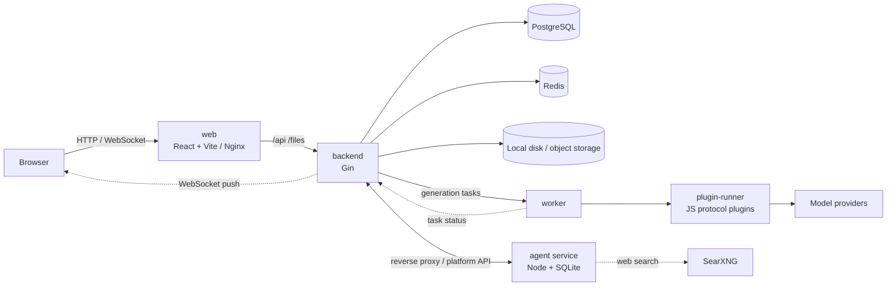

# Development guide

This guide is for contributors to 连镜 (`video-canvas`). It covers the development environment, the overall architecture, and the checks your changes must pass. For deployment and usage, see the root [README](../README.en.md). Most linked documents are in Chinese.

## Requirements

| Setup              | Requirements                                                                                                  |
| ------------------ | ------------------------------------------------------------------------------------------------------------- |
| Docker development | Docker (with Compose v2)                                                                                      |
| Local development  | Go 1.27, [Bun](https://bun.sh) 1.3, PostgreSQL 16, Redis 7; Node.js 22.19+ if you work on the Canvas Agent runtime |

## Docker development environment

```bash
git clone https://github.com/zaylora/video-canvas.git
cd video-canvas
./scripts/start-docker.sh  # On Windows run scripts/start-docker.bat; add -d to run in the background
```

The first build takes a few minutes. Once it is up:

| Service              | Address                                                      |
| -------------------- | ------------------------------------------------------------ |
| Frontend             | <http://localhost:5173>                                      |
| Backend health check | <http://localhost:8080/health>                               |
| PostgreSQL           | `localhost:15432` (postgres / root, database `video_canvas`) |
| Redis                | `localhost:16379`                                            |

Common commands (logs, running tests inside containers, resetting data) are in [Docker development](docker-development.md).

## Local development

```bash
# Create a local config (gitignored) and adjust the database connection etc.
cp backend/configs/config.yaml backend/configs/config.local.yaml

./scripts/start.sh  # On Windows run scripts/start.bat; Ctrl+C stops both frontend and backend
```

- The script builds the backend and starts Vite. The frontend proxies `/api` and `/files` to `:8080`.
- The backend reads `config.local.yaml` first. Any setting can be overridden with an environment variable named `APP_` plus the upper-cased config path, for example `APP_DATABASE_DSN`.
- Set `redis.enabled: false` to run without Redis; the cache layer then queries the database directly.
- All configuration options are listed in [backend/README.md](../backend/README.md).

## Architecture



- **Request path**: The backend is layered as `router → middleware → handler → service → repository / cache`.
- **Asynchronous generation**: Submitting a task returns immediately. The worker calls model providers through the plugin-runner, and status updates are pushed to the frontend over WebSocket. After a reconnect, the frontend reconciles tasks to pick up updates it missed.
- **Protocol plugins**: Each provider protocol is a JS plugin running in an isolated plugin-runner process. See [plugin-contract.md](../backend/docs/plugin-contract.md).
- **Canvas Agent**: The Agent is a standalone long-running service (`agent/`, Pi Durable + SQLite) that owns sessions, runs, approvals and events and holds no channel secrets. The Go backend checks the login and reverse-proxies the frontend's Agent APIs to it, and exposes a platform API (canvas read/write, model proxy and billing, generation tasks, assets); the Agent's events are pushed through Go to the WebSocket.
- **Canvas saving**: Canvases are saved with `revision`-based optimistic locking; a version conflict returns 409.
- **Production**: Besides the services above, the production Compose file includes an `updater` service for in-app upgrades and rollbacks.

### Tech stack

| Layer       | Technology                                                                                |
| ----------- | ----------------------------------------------------------------------------------------- |
| Frontend    | React 19 · TypeScript · Vite · Tailwind CSS 4 · shadcn/ui · React Flow · zustand · Motion |
| Backend     | Go 1.27 · Gin · GORM · go-redis · Viper · Zap · goja                                      |
| Agent       | Node.js 22 · pi agent                                                                     |
| Storage     | PostgreSQL 16 (required) · Redis 7 · local disk / object storage (OSS · COS · S3 · R2)    |
| Engineering | golangci-lint · oxlint / oxfmt · pre-commit · GitHub Actions · git-cliff                  |

## Project layout

```text
video-canvas/
├── backend/        # Go backend: API, generation worker, plugin-runner, built-in plugins, updater
├── web/            # React frontend: home and conversations, canvas, director's desk, asset library, admin console
├── agent/          # Node runtime for the Canvas Agent
├── docs/           # Deployment docs, development guide, design docs, plans
├── scripts/        # Deploy, update and startup scripts
├── docker-compose.dev.yml   # Development
└── docker-compose.yml       # Production (GHCR images)
```

## Coding standards

| Scope       | Standard                                                                                                     |
| ----------- | ------------------------------------------------------------------------------------------------------------ |
| Repository  | [AGENTS.md](../AGENTS.md): directory responsibilities, testing conventions                                   |
| Backend     | [backend/AGENTS.md](../backend/AGENTS.md) (hard rules) · [backend standards](../backend/docs/standards/README.md) |
| Frontend    | [web/docs/coding-standards.md](../web/docs/coding-standards.md)                                              |
| UI design   | [.agents/skills/ui-design/SKILL.md](../.agents/skills/ui-design/SKILL.md)                                    |

## Common development tasks

Read [AGENTS.md](../AGENTS.md) and the rules of the directory you are touching first, and write a failing test before the implementation.

| Task                              | How                                                                                                                                                                                                            |
| --------------------------------- | -------------------------------------------------------------------------------------------------------------------------------------------------------------------------------------------------------------- |
| Add a backend API / module        | Follow the "checklist for adding an API / module" in [backend/AGENTS.md](../backend/AGENTS.md): model → errcode → repository → service → handler → router → wiring in `initialize/app.go` → tests → API table |
| Change the database schema        | Change `internal/model` and add `NNNN_description.sql` under `backend/migrations/`. Released migrations are immutable; dropping or renaming columns takes two releases. Check state with `go run ./cmd/server migrate status` |
| Add / change a protocol plugin    | Built-in plugins live in `backend/plugins/*.js`. A plugin only translates "task → request" and "response → unified result" and must be pure. [plugin-contract.md](../backend/docs/plugin-contract.md) is the source of truth; change it first |
| Frontend pages / components       | Follow the [frontend coding standards](../web/docs/coding-standards.md); read [ui-design](../.agents/skills/ui-design/SKILL.md) before UI or interaction changes; API calls live in `web/src/api/`, tests in `web/src/tests/` |
| Change the Canvas Agent           | The runtime is in `agent/` (run `npm test` there); the Go side is in `backend/internal/agent/`, `internal/service/agent/` and `internal/handler/agent/`                                                       |
| Build a larger feature            | Write a design record in `docs/design/` first (background, decisions, trade-offs), then implement, and keep it updated when the design changes                                                                  |

### Line endings and encoding

The repository uses LF line endings (see `.gitattributes`; `.bat` files are the CRLF exception). On Windows with `core.autocrlf=true`, `make lint` may report false formatting issues; see the [backend standards](../backend/docs/standards/README.md).

## Tests and checks

Write a failing test that reproduces the requirement or bug before implementing a feature, fix or refactor. Backend tests live in `backend/internal/tests/`, frontend tests in `web/src/tests/`.

Before submitting, make sure these pass:

```bash
# Backend (in backend/)
make fmt && make lint && make test

# Frontend (in web/)
bun run typecheck && bun run lint && bun run format:check && bun test

# Agent runtime (in agent/, only when you change it)
npm test
```

Format frontend code only with the bundled oxfmt (`bun run format`). Do not use Prettier or your editor's formatter, as they restyle unrelated code.

Installing the Git hooks is recommended so these checks run on commit:

```bash
pre-commit install
```

## Commit messages and pull requests

Use [Conventional Commits](https://www.conventionalcommits.org/en/v1.0.0/) with the module as the scope and an ASCII colon after the type. Descriptions are written in Chinese in this project, for example:

```text
feat(canvas): 支持节点分组
docs: 更新部署说明
```

The changelog is generated from commit messages with git-cliff, so they appear in release notes as written.

Branch naming, commit granularity, PR descriptions, how to file issues, and the review and merge process are in the [contributing guide](../CONTRIBUTING.en.md).

## CI and releases

- Pushes to `master` run lint, build and tests for both backend and frontend.
- Migrations only move forward: migration files included in the latest `v*` tag must not be modified, deleted or renamed. Add a new migration instead, or CI will fail.
- Pushing a `v*` tag makes CI check that the tag, `VERSION` and [CHANGELOG.md](../CHANGELOG.md) agree, build the `video-canvas-backend` and `video-canvas-web` images, publish them to GHCR, and then create a GitHub Release.
- So when releasing, update `VERSION` to the target version and commit it together with the changelog before creating and pushing the tag.

## Related documents

| Topic                                 | Document                                                                                                         |
| ------------------------------------- | ---------------------------------------------------------------------------------------------------------------- |
| Backend structure, configuration, API | [backend/README.md](../backend/README.md)                                                                        |
| AI admin API, plugin contract         | [admin-ai-api.md](../backend/docs/admin-ai-api.md) · [plugin-contract.md](../backend/docs/plugin-contract.md)    |
| Docker development / production       | [docker-development.md](docker-development.md) · [docker-production.md](docker-production.md)                    |
| Product and interaction design        | [design/](design/)                                                                                               |
