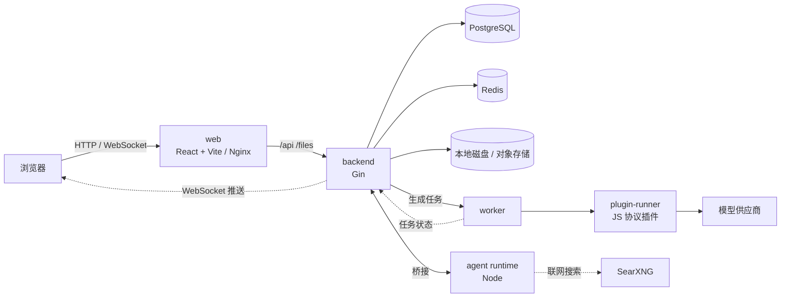

# 开发指南

本文面向参与连镜（`video-canvas`）开发的贡献者，说明如何搭建开发环境、项目的整体架构，以及提交代码前需要通过的检查。部署和使用见根目录 [README](../README.md)。

## 环境要求

| 方式        | 需要                                                                                         |
| ----------- | -------------------------------------------------------------------------------------------- |
| Docker 开发 | Docker（含 Compose v2）                                                                       |
| 本地开发    | Go 1.27、[Bun](https://bun.sh) 1.3、PostgreSQL 16、Redis 7；开发画布 Agent 还需要 Node.js 22.19+ |

## Docker 开发环境

```bash
git clone https://github.com/zaylora/video-canvas.git
cd video-canvas
./scripts/start-docker.sh  # Windows 运行 scripts/start-docker.bat；加 -d 后台启动
```

首次构建需要几分钟。启动后：

| 服务         | 地址                                                    |
| ------------ | ------------------------------------------------------- |
| 前端         | <http://localhost:5173>                                 |
| 后端健康检查 | <http://localhost:8080/health>                          |
| PostgreSQL   | `localhost:15432`（postgres / root，库 `video_canvas`） |
| Redis        | `localhost:16379`                                       |

查看日志、在容器里跑测试、清理数据等常用命令见 [Docker 开发环境](docker-development.md)。

## 本地开发

```bash
# 复制一份本地配置（已被 gitignore），按需修改数据库连接等
cp backend/configs/config.yaml backend/configs/config.local.yaml

./scripts/start.sh  # Windows 运行 scripts/start.bat；Ctrl+C 同时停止前后端
```

- 脚本会编译后端并启动 Vite，前端把 `/api` 和 `/files` 代理到 `:8080`。
- 后端优先读取 `config.local.yaml`。每个配置项都可以用环境变量覆盖，规则是 `APP_` 前缀加大写的配置路径，例如 `APP_DATABASE_DSN`。
- 设置 `redis.enabled: false` 可以不启用 Redis，缓存层会直接查数据库。
- 完整配置项见 [backend/README.md](../backend/README.md)。

## 架构



- **请求链路**：后端按 `router → middleware → handler → service → repository / cache` 分层。
- **异步生成**：提交生成任务后立即返回，worker 通过 plugin-runner 调用模型供应商，状态经 WebSocket 推给前端。前端断线重连后会对账，补上断线期间的更新。
- **协议插件**：每种供应商协议是一个 JS 插件，运行在隔离的 plugin-runner 进程中。插件契约见 [plugin-contract.md](../backend/docs/plugin-contract.md)。
- **画布 Agent**：Agent 循环运行在独立的 Node 进程（`agent/`）里，进程内不保存任何密钥，模型调用、工具执行和状态读写都经桥接回到 Go 后端。
- **画布保存**：按 `revision` 乐观锁保存，版本冲突时返回 409。
- **生产部署**：除上图服务外，生产 Compose 还包含 `updater`，用于后台一键升级和回退。

### 技术栈

| 层   | 技术                                                                                    |
| ---- | --------------------------------------------------------------------------------------- |
| 前端 | React 19 · TypeScript · Vite · Tailwind CSS 4 · shadcn/ui · React Flow · zustand · Motion |
| 后端 | Go 1.27 · Gin · GORM · go-redis · Viper · Zap · goja                                    |
| Agent | Node.js 22 · pi agent                                                                  |
| 存储 | PostgreSQL 16（必需）· Redis 7 · 本地磁盘 / 对象存储（OSS · COS · S3 · R2）             |
| 工程 | golangci-lint · oxlint / oxfmt · pre-commit · GitHub Actions · git-cliff                |

## 目录结构

```text
video-canvas/
├── backend/        # Go 后端：API、生成任务 worker、plugin-runner、内置插件、updater
├── web/            # React 前端：首页与对话、画布、导演台、资产库、管理后台
├── agent/          # 画布 Agent 的 Node 运行时
├── docs/           # 部署文档、开发指南、设计文档、开发计划
├── scripts/        # 部署、更新、启动脚本
├── docker-compose.dev.yml   # 开发环境
└── docker-compose.yml       # 生产环境（GHCR 镜像）
```

## 代码规范

| 范围      | 规范                                                                                                                       |
| --------- | -------------------------------------------------------------------------------------------------------------------------- |
| 全项目    | [AGENTS.md](../AGENTS.md)：目录职责、测试约定                                                                              |
| 后端      | [backend/AGENTS.md](../backend/AGENTS.md)（硬性规则）· [后端代码规范](../backend/docs/standards/README.md)                 |
| 前端      | [web/docs/coding-standards.md](../web/docs/coding-standards.md)                                                            |
| 界面设计  | [.agents/skills/ui-design/SKILL.md](../.agents/skills/ui-design/SKILL.md)                                                  |

## 常见开发任务

动手前先读 [AGENTS.md](../AGENTS.md) 和目标目录的规则，并按 TDD 先写失败测试。

| 任务                 | 怎么做                                                                                                                                                                                         |
| -------------------- | ---------------------------------------------------------------------------------------------------------------------------------------------------------------------------------------------- |
| 新增后端接口 / 模块  | 按 [backend/AGENTS.md](../backend/AGENTS.md) 的「新增一个接口 / 模块的步骤清单」逐步完成：model → errcode → repository → service → handler → router → `initialize/app.go` 组装 → 测试 → 更新接口表 |
| 改数据库表结构       | 改 `internal/model` 的同时在 `backend/migrations/` 新增 `NNNN_描述.sql`；已发布的迁移不能改，删列、改名分两个版本做。`go run ./cmd/server migrate status` 查看迁移状态                           |
| 新增 / 修改协议插件  | 内置插件在 `backend/plugins/*.js`，插件只做“任务 → 请求”和“响应 → 统一结果”的翻译，必须是纯函数。字段以 [plugin-contract.md](../backend/docs/plugin-contract.md) 为准，改契约先改文档            |
| 前端页面 / 组件      | 遵循 [前端代码规范](../web/docs/coding-standards.md)；界面和交互改动先读 [ui-design](../.agents/skills/ui-design/SKILL.md)；接口调用统一放 `web/src/api/`，测试放 `web/src/tests/`            |
| 改画布 Agent         | 运行时在 `agent/`，改动后在该目录跑 `npm test`；Go 侧在 `backend/internal/agent/`、`internal/service/agent/`、`internal/handler/agent/`                                                       |
| 做较大的功能         | 先在 `docs/design/` 写设计记录（背景、决定、取舍），再实现；设计变化时同步更新                                                                                                                  |

### 换行与文件编码

仓库统一使用 LF 换行（见 `.gitattributes`，`.bat` 例外为 CRLF）。Windows 上若 `core.autocrlf=true`，`make lint` 可能误报格式问题，详见 [后端工程化规范](../backend/docs/standards/README.md)。

## 测试与检查

功能、修复和重构都先写能复现需求或问题的失败测试，再实现。后端测试放在 `backend/internal/tests/`，前端测试放在 `web/src/tests/`。

提交前需要通过：

```bash
# 后端（在 backend/ 下）
make fmt && make lint && make test

# 前端（在 web/ 下）
bun run typecheck && bun run lint && bun run format:check && bun test

# Agent 运行时（在 agent/ 下，仅改动它时需要）
npm test
```

前端格式化只用仓库自带的 oxfmt（`bun run format`），不要用 Prettier 或编辑器自带的格式化，以免改动无关代码的风格。

推荐安装 Git 钩子，提交时自动检查：

```bash
pre-commit install
```

## 提交信息与 Pull Request

使用 [Conventional Commits](https://www.conventionalcommits.org/zh-hans/)，范围写模块名，描述用中文，type 后用半角冒号，例如：

```text
feat(canvas): 支持节点分组
docs: 更新部署说明
```

CHANGELOG 由 git-cliff 根据提交信息生成，提交信息会直接出现在版本日志里。

分支命名、提交粒度、PR 描述、Issue 填写和评审合并流程见 [贡献指南](../CONTRIBUTING.md)。

## 持续集成与发布

- 推送到 `master` 时，CI 运行前后端的 lint、构建和测试。
- 数据库迁移只能向前：最近一个 `v*` 标签里已有的迁移文件不能修改、删除或改名，要修正就新增迁移文件，否则 CI 不通过。
- 推送 `v*` 标签时，CI 先校验标签、`VERSION` 和 [CHANGELOG.md](../CHANGELOG.md) 是否一致，再构建 `video-canvas-backend` 和 `video-canvas-web` 两个镜像发布到 GHCR，成功后创建 GitHub Release。
- 因此发版时要先把 `VERSION` 改为目标版本，和 CHANGELOG 一起提交，再创建并推送标签。

## 相关文档

| 内容                         | 文档                                                                                                 |
| ---------------------------- | ---------------------------------------------------------------------------------------------------- |
| 后端结构、配置项、完整接口表 | [backend/README.md](../backend/README.md)                                                            |
| AI 管理接口、插件契约        | [admin-ai-api.md](../backend/docs/admin-ai-api.md) · [plugin-contract.md](../backend/docs/plugin-contract.md) |
| Docker 开发 / 生产部署       | [docker-development.md](docker-development.md) · [docker-production.md](docker-production.md)        |
| 产品与交互设计               | [design/](design/)                                                                                   |
